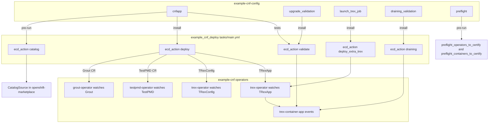

# example-cnf-config

Samples files to deploy and enable CNF application based on DPDK (could be either [TestPMD](https://doc.dpdk.org/guides/testpmd_app_ug/) or [Grout](https://github.com/DPDK/grout/)) with `dci-openshift-app-agent` and `dci-pipeline`.

## Related projects

- [example-cnf project](https://github.com/openshift-kni/example-cnf): here you will find the images in which example-cnf operators and workloads are based.
- [example_cnf_deploy Ansible role](https://github.com/redhatci/ansible-collection-redhatci-ocp/blob/main/roles/example_cnf_deploy/README.md): here you will find the Ansible role used to support the automation of this hook.
- [example-cnf pipelines](https://github.com/dci-labs/dallas-pipelines): here you can find the pipelines (prefixed with `example-cnf`) to deploy the different scenarios to test example-cnf. Please refer to [dci-pipeline docs](https://doc.distributed-ci.io/dci-pipeline/) to review how `dci-pipeline` works and how to deploy your pipeline.

## Scenarios

### How the automation is split

Each scenario in this repo is a DCI hook directory. A hook stage calls [`redhatci.ocp.example_cnf_deploy`](https://github.com/redhatci/ansible-collection-redhatci-ocp/blob/main/roles/example_cnf_deploy/tasks/main.yml) with `ecd_action`, and that role creates custom resources. The operators in [openshift-kni/example-cnf](https://github.com/openshift-kni/example-cnf) reconcile those resources. Operator behavior lives in the Ansible roles under `grout-operator`, `testpmd-operator`, and `trex-operator` (`watches.yaml` selects the role). The deploy action installs the operator that matches `ecd_cnfapp_name` (`grout` or `testpmd`) together with the TRex operator. TRex job results are Kubernetes events emitted by [trex-container-app](https://github.com/openshift-kni/example-cnf/blob/main/trex-container-app/app/pyfiles/trexstats.py).

| Scenario | Pre-run | Install | Tests | Teardown |
|----------|---------|---------|-------|----------|
| [cnfapp](cnfapp/README.md) | Namespace, policies, SR-IOV, catalog (`ecd_action=catalog`) | Operators and workloads (`ecd_action=deploy`) | Pod migration and packet-loss check (`ecd_action=validate`), opcap | Delete namespace, catalog, SR-IOV |
| [upgrade_validation](upgrade_validation/README.md) | Facts only (`example-cnf`, TestPMD) | Clear previous TRex events, then `ecd_action=validate` | — | — |
| [launch_trex_job](launch_trex_job/README.md) | Resolve catalog digest and `trex-container-app` image | Clear previous TRex events, then `ecd_action=deploy_extra_trex` | — | — |
| [draining_validation](draining_validation/README.md) | Facts only (`example-cnf`, TestPMD) | `ecd_action=draining` | — | — |
| [preflight](preflight/README.md) | Build `preflight_*_to_certify` from the index | Empty hook | — | — |

Stage diagrams for each case are in that scenario's README.

### CNFApp deployment

This implies the deployment of example-cnf operators and workloads. See [cnfapp doc](cnfapp/README.md).

### Upgrade validation

> This scenario is only supported by TestPMD for the time being.

When running example-cnf during an upgrade, an extra DCI hook can be called to gather information about the CNF behavior. See [upgrade_validation doc](upgrade_validation/README.md).

### Launch a new TRex job

> This scenario is only supported by TestPMD for the time being.

If you want to launch a new TRex job on an already deployed example-cnf instance, use the launch_trex_job hook. See [launch_trex_job docs](launch_trex_job/README.md) for more details.

### Node draining validation

> This scenario is only supported by TestPMD for the time being.

If example-cnf is launched in continuous mode (or emulating continuous mode with a long TRex job duration), we can use [draining validation](draining_validation/README.md) to emulate a node draining process that impacts in the worker node where TestPMD pod is deployed and TRex is running, then TestPMD pod needs to be reallocated, and consequently packet loss starts to appear.

### Preflight preparation

Please check [preflight](preflight/README.md) to see how to prepare preflight variables to test some of the example-cnf components with preflight.
