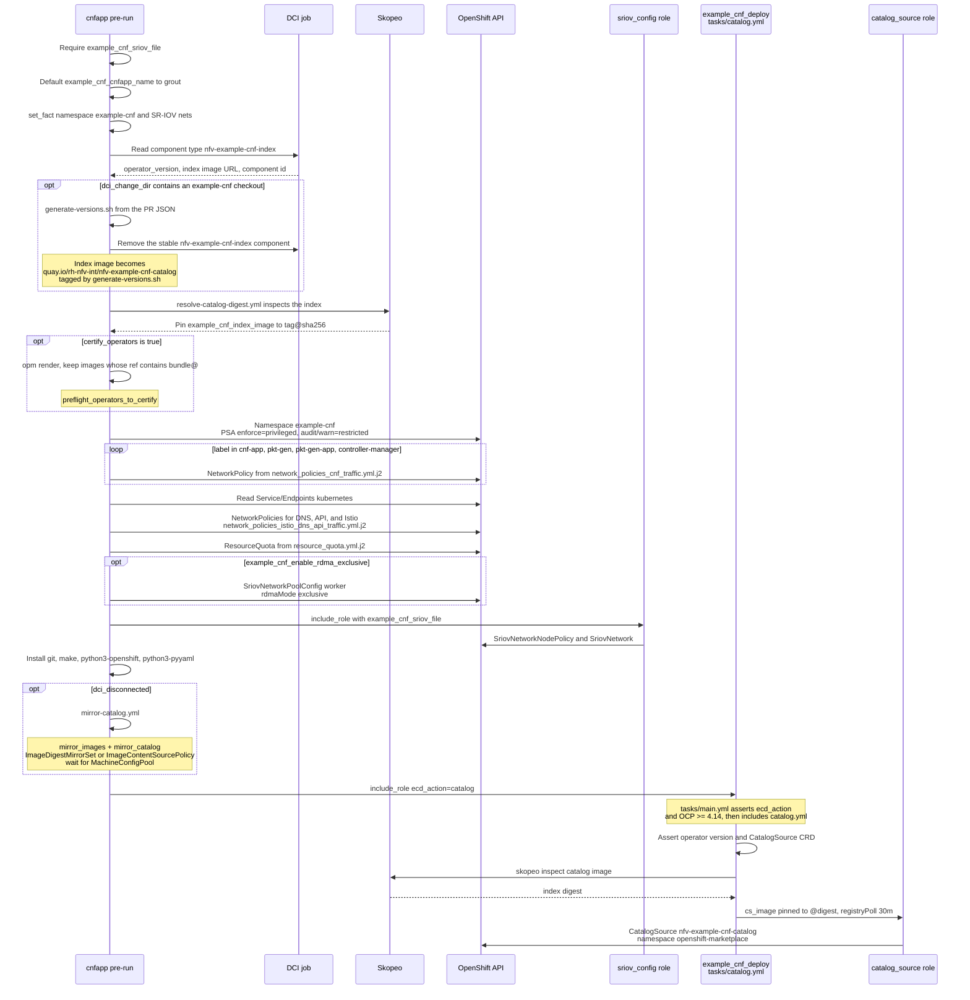
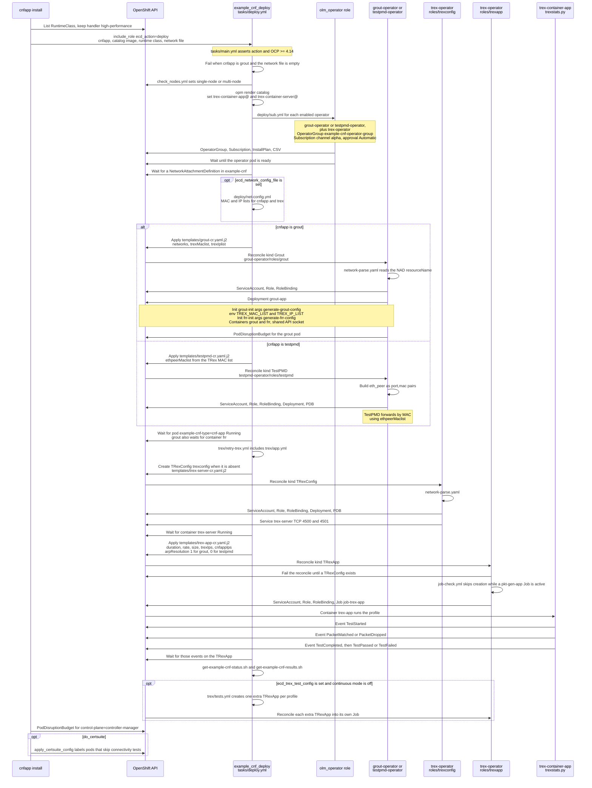
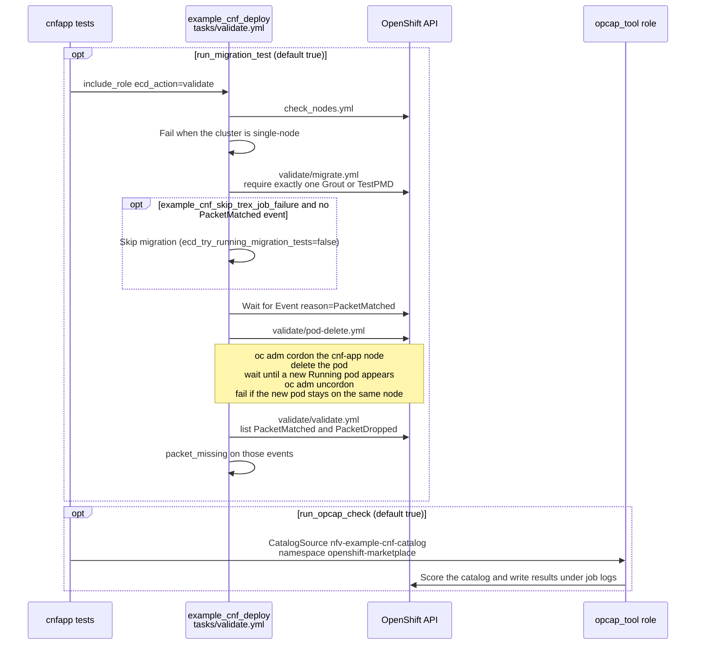
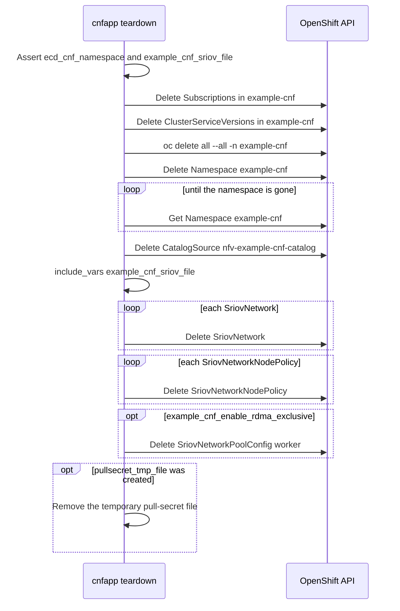

# CNFApp

This hook deploys all resources from example-cnf scenario, then launches TRex job to evaluate the packet loss ratio in the deployment made.

We can use either [TestPMD](https://doc.dpdk.org/guides/testpmd_app_ug/) or [Grout](https://github.com/DPDK/grout/) as CNF application. Both are based on DPDK.

Some variables than can be used for debugging purposes:

| Name                              | Required | Default    | Description                                                                                           |
|-----------------------------------|----------|------------|-------------------------------------------------------------------------------------------------------|
| example_cnf_enable_rdma_exclusive | No       | false      | Enable RDMA exclusive mode to configure a RDMA subsystem for SRIOV. This requires a specific setup for the SriovNetwork, please check [this documentation](https://docs.redhat.com/en/documentation/openshift_container_platform/4.18/html/networking/hardware-networks#nw-sriov-networknodepolicy-object_configuring-sriov-device). This procedure only applies to Mellanox NICs. |
| example_cnf_cnfapp_name           | No       | grout      | CNFApp to be used. Could be "grout" or "testpmd"                                                      |
| example_cnf_skip_trex_job_failure | No       | false      | If true, do not fail the job if TRex job fails                                                        |
| example_cnf_sriov_file            | Yes      | ''         | Path to find the SRIOV config file, to generate SriovNetworkNodePolicy and SriovNetwork
| example_cnf_network_config_file   | No       | ''         | Path to find the network config file to provide IP-MAC config to TRex and CNFApp (required for Grout) |
| run_migration_test                | No       | true       | Enable migration tests                                                                                |
| run_opcap_check                   | No       | true       | Enable opcap check                                                                                    |

## Pod Security Admission

The `example-cnf` namespace is created with `pod-security.kubernetes.io/enforce: privileged` because DPDK/SR-IOV workloads need capabilities and device access that are not allowed under the `baseline` or `restricted` Pod Security Standards (for example `IPC_LOCK`, `NET_ADMIN`, and vfio). SCC-to-PSA label sync is disabled so OpenShift does not overwrite that choice.

`audit` and `warn` are set to `restricted` so pods that would violate the restricted profile are still recorded and warned about, without failing admission for the lab/CI workload. This namespace is ephemeral and removed during teardown; it is not intended as a production security boundary.

## Automation

Three layers run this scenario:

1. Hooks in [cnfapp/hooks](hooks).
2. [`redhatci.ocp.example_cnf_deploy`](https://github.com/redhatci/ansible-collection-redhatci-ocp/blob/main/roles/example_cnf_deploy/tasks/main.yml), dispatched by `ecd_action`.
3. Operators in [openshift-kni/example-cnf](https://github.com/openshift-kni/example-cnf). `watches.yaml` maps each CR to an Ansible role: [Grout](https://github.com/openshift-kni/example-cnf/blob/main/grout-operator/roles/grout/tasks/main.yml), [TestPMD](https://github.com/openshift-kni/example-cnf/blob/main/testpmd-operator/roles/testpmd/tasks/main.yml), [TRexConfig](https://github.com/openshift-kni/example-cnf/blob/main/trex-operator/roles/trexconfig/tasks/main.yml), and [TRexApp](https://github.com/openshift-kni/example-cnf/blob/main/trex-operator/roles/trexapp/tasks/main.yml).

### Pre-run

[hooks/pre-run.yml](hooks/pre-run.yml) prepares the namespace and publishes the example-cnf catalog. The catalog step is `ecd_action: catalog`, which runs [tasks/catalog.yml](https://github.com/redhatci/ansible-collection-redhatci-ocp/blob/main/roles/example_cnf_deploy/tasks/catalog.yml) and then [`redhatci.ocp.catalog_source`](https://github.com/redhatci/ansible-collection-redhatci-ocp/blob/main/roles/catalog_source/tasks/main.yml).

**OpenShift resources created in pre-run**

| Resource | Namespace | Created by |
|----------|-----------|------------|
| Namespace `example-cnf` | — | hook |
| NetworkPolicy (CNF traffic, DNS, API, Istio) | example-cnf | hook templates |
| ResourceQuota | example-cnf | hook template |
| SriovNetworkPoolConfig `worker` | openshift-sriov-network-operator | hook, when RDMA exclusive is enabled |
| SriovNetworkNodePolicy, SriovNetwork | openshift-sriov-network-operator | `redhatci.ocp.sriov_config` |
| CatalogSource `nfv-example-cnf-catalog` | openshift-marketplace | `example_cnf_deploy` `catalog` → `catalog_source` |

### Install

[hooks/install.yml](hooks/install.yml) selects the high-performance RuntimeClass, then calls the role with `ecd_action: deploy` ([tasks/deploy.yml](https://github.com/redhatci/ansible-collection-redhatci-ocp/blob/main/roles/example_cnf_deploy/tasks/deploy.yml)). Operator install is [tasks/deploy/sub.yml](https://github.com/redhatci/ansible-collection-redhatci-ocp/blob/main/roles/example_cnf_deploy/tasks/deploy/sub.yml) through [`redhatci.ocp.olm_operator`](https://github.com/redhatci/ansible-collection-redhatci-ocp/blob/main/roles/olm_operator/tasks/main.yml). Workload CRs are created in [tasks/deploy/app.yml](https://github.com/redhatci/ansible-collection-redhatci-ocp/blob/main/roles/example_cnf_deploy/tasks/deploy/app.yml) and [tasks/trex/app.yml](https://github.com/redhatci/ansible-collection-redhatci-ocp/blob/main/roles/example_cnf_deploy/tasks/trex/app.yml).

**Custom resources and what the operator turns them into**

| CR from the role | Operator role | Workload |
|------------------|---------------|----------|
| `Grout` [grout-cr.yaml.j2](https://github.com/redhatci/ansible-collection-redhatci-ocp/blob/main/roles/example_cnf_deploy/templates/grout-cr.yaml.j2) | [grout/tasks/main.yml](https://github.com/openshift-kni/example-cnf/blob/main/grout-operator/roles/grout/tasks/main.yml) | Deployment with `grout-init`, `frr-init`, `grout`, `frr` |
| `TestPMD` [testpmd-cr.yaml.j2](https://github.com/redhatci/ansible-collection-redhatci-ocp/blob/main/roles/example_cnf_deploy/templates/testpmd-cr.yaml.j2) | [testpmd/tasks/main.yml](https://github.com/openshift-kni/example-cnf/blob/main/testpmd-operator/roles/testpmd/tasks/main.yml) | Deployment, MAC forwarding via `eth_peer` |
| `TRexConfig` [trex-server-cr.yaml.j2](https://github.com/redhatci/ansible-collection-redhatci-ocp/blob/main/roles/example_cnf_deploy/templates/trex-server-cr.yaml.j2) | [trexconfig/tasks/main.yml](https://github.com/openshift-kni/example-cnf/blob/main/trex-operator/roles/trexconfig/tasks/main.yml) | TRex server Deployment, PDB, Service `trex-server` |
| `TRexApp` [trex-app-cr.yaml.j2](https://github.com/redhatci/ansible-collection-redhatci-ocp/blob/main/roles/example_cnf_deploy/templates/trex-app-cr.yaml.j2) | [trexapp/tasks/main.yml](https://github.com/openshift-kni/example-cnf/blob/main/trex-operator/roles/trexapp/tasks/main.yml) and [job-check.yml](https://github.com/openshift-kni/example-cnf/blob/main/trex-operator/roles/trexapp/tasks/job-check.yml) | Job `job-<cr-name>`; events from [trexstats.py](https://github.com/openshift-kni/example-cnf/blob/main/trex-container-app/app/pyfiles/trexstats.py) |

### Tests

[hooks/tests.yml](hooks/tests.yml) calls `ecd_action: validate` ([tasks/validate.yml](https://github.com/redhatci/ansible-collection-redhatci-ocp/blob/main/roles/example_cnf_deploy/tasks/validate.yml)) and, separately, `redhatci.ocp.opcap_tool`.

### Teardown

[hooks/teardown.yml](hooks/teardown.yml) deletes the objects this scenario created. Every delete in this stage is a task in the hook.

