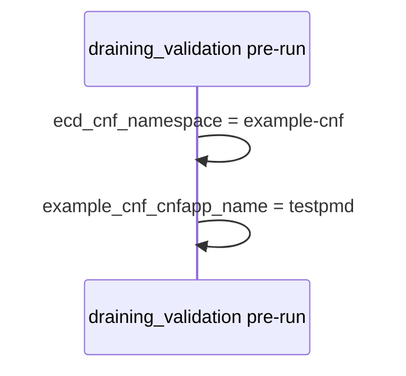
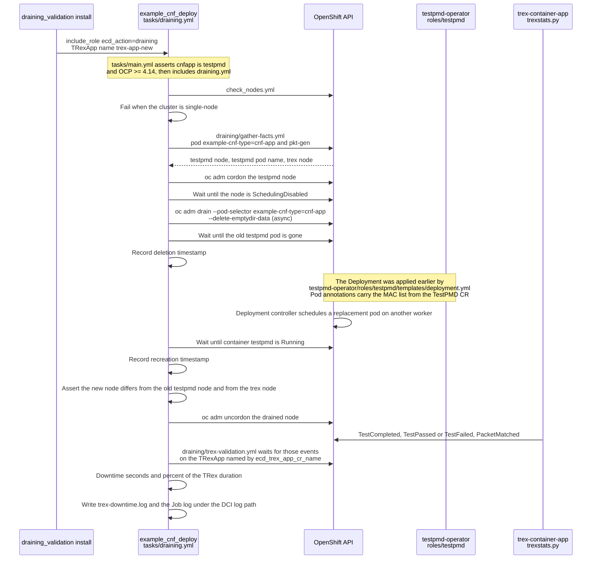

# Draining validation

If example-cnf is launched in continuous mode (or emulating continuous mode with a long TRex job duration), we can use this hook to emulate a node draining process that impacts in the worker node where testpmd pod is deployed, then it needs to be reallocated, and consequently packet loss starts to appear.

For this to work, some requirements need to be met:

- example-cnf needs to be deployed in continuous mode or emulating continuous mode, as said before.
- The MAC addresses used by testpmd pod need to be hardcoded, to ensure the same MAC addresses are used in the new pod scheduled in a different worker node.
- There must be 3+ worker nodes to allow testpmd being reallocated in a different worker, also different than the worker node where trex is running.

Some variables than can be used for debugging purposes:

| Name                              | Required | Default      | Description                                      |
|-----------------------------------|----------|..------------|--------------------------------------------------|
| example_cnf_cnfapp_name           | No       | testpmd      | CNFApp to be used. Only "testpmd" can be used    |
| trex_app_cr_name_to_check         | No       | trex-app-new | Name of the TRexApp CR to create                |

## Automation

This scenario runs while a TestPMD deployment and a long TRex job are already in the cluster (see [cnfapp](../cnfapp/README.md) and [launch_trex_job](../launch_trex_job/README.md)). Install calls `ecd_action: draining` ([tasks/draining.yml](https://github.com/redhatci/ansible-collection-redhatci-ocp/blob/main/roles/example_cnf_deploy/tasks/draining.yml)). The TestPMD operator keeps the Deployment, so deleting the pod schedules a replacement. Packet-loss events still come from [trexstats.py](https://github.com/openshift-kni/example-cnf/blob/main/trex-container-app/app/pyfiles/trexstats.py) on the TRexApp Job.

### Pre-run

[hooks/pre-run.yml](hooks/pre-run.yml) only sets facts.

### Install

