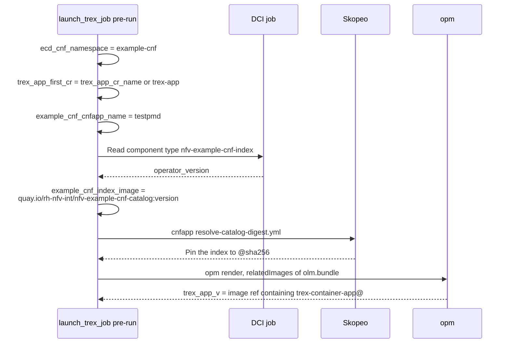
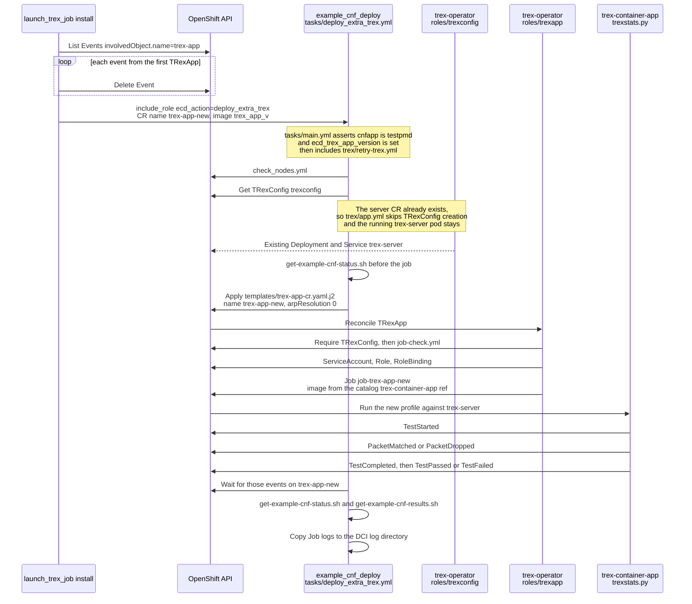

# Launch TRex job

On an already deployed example-cnf, this hook deploys a new TRexApp job, to check if a new TRex execution achieves the same result than the previous iteration.

This hook reuses the retry-trex play, included in the example_cnf_deploy role from [redhatci.ocp collection](https://github.com/redhatci/ansible-collection-redhatci-ocp/blob/main/roles/example_cnf_deploy/README.md).

To ensure the previous run of TRex (usually the default CR) is not polluting the results, all the event from the previous CR are removed.

Some variables than can be used for debugging purposes:

| Name                              | Required | Default      | Description                                      |
|-----------------------------------|----------|--------------|--------------------------------------------------|
| trex_app_cr_name                  | Yes      | 'trex-app'   | Name of the initial CR that will be cleaned      |
| example_cnf_cnfapp_name           | No       | testpmd      | CNFApp to be used. Only "testpmd" can be used    |
| trex_app_new_cr_name              | No       | trex-app-new | Name of the TRexApp CR to create                 |

## Automation

This scenario runs against an example-cnf install that is already up (see [cnfapp](../cnfapp/README.md)). Pre-run resolves the catalog. Install clears events from the first TRexApp, then calls `ecd_action: deploy_extra_trex` ([tasks/deploy_extra_trex.yml](https://github.com/redhatci/ansible-collection-redhatci-ocp/blob/main/roles/example_cnf_deploy/tasks/deploy_extra_trex.yml)), which includes [tasks/trex/retry-trex.yml](https://github.com/redhatci/ansible-collection-redhatci-ocp/blob/main/roles/example_cnf_deploy/tasks/trex/retry-trex.yml) and [tasks/trex/app.yml](https://github.com/redhatci/ansible-collection-redhatci-ocp/blob/main/roles/example_cnf_deploy/tasks/trex/app.yml).

The TRex server is left as-is. A new `TRexApp` is reconciled by [trex-operator/roles/trexapp](https://github.com/openshift-kni/example-cnf/blob/main/trex-operator/roles/trexapp/tasks/main.yml). The Job container publishes results from [trexstats.py](https://github.com/openshift-kni/example-cnf/blob/main/trex-container-app/app/pyfiles/trexstats.py).

### Pre-run

### Install

