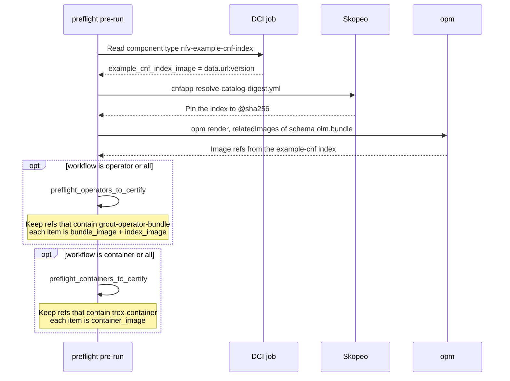

# Example CNF Preflight Configuration

This directory provides the configuration for running [Red Hat Preflight](https://github.com/redhat-openshift-ecosystem/openshift-preflight) certification tests within a Distributed CI (DCI) pipeline targeting Cloud-Native Network Functions (CNFs).

## What is Preflight?

Preflight is a tool provided by Red Hat to automate the certification process for containers and operators. It helps validate that components (such as the example-cnf operator or workload containers) are ready for certification and follow the required best practices.

## Summary of Tasks Performed Per Hook

The `preflight` directory contains several Ansible hooks involved in preparing and executing Preflight certification checks against the Example CNF components. Most important one is the [pre-run hook](hooks/pre-run.yml), where we have the following tasks:

- Extract information from the nfv-example-cnf-index component (required in the pipeline definition).
- Build `preflight_operators_to_certify` variable based on the index content.
    - We will take grout-operator-bundle for this test.
- Build `preflight_containers_to_certify` variable based on the index content.
    - We will take trex-container images for this test.
- Workflow selection with `example_cnf_preflight_workflow` variable:
    - The `example_cnf_preflight_workflow` variable provides fine-grained control over which certification checks are executed. Its value can be set to `"all"`, `"operator"`, or `"container"`.

## Automation

[hooks/pre-run.yml](hooks/pre-run.yml) reads the `nfv-example-cnf-index` DCI component and turns catalog related images into the variables later preflight stages consume. [hooks/install.yml](hooks/install.yml) is empty. The bundle and container refs come from the same index image the [cnfapp catalog step](../cnfapp/README.md) publishes, which is built from [openshift-kni/example-cnf](https://github.com/openshift-kni/example-cnf).

`example_cnf_preflight_workflow` selects which lists are filled: `all` fills both, `operator` fills only the bundle list, `container` fills only the container list.

### Pre-run

The operator bundle in that list is [grout-operator](https://github.com/openshift-kni/example-cnf/tree/main/grout-operator). The container ref is the TRex workload image shipped in the same catalog, used by [trex-operator](https://github.com/openshift-kni/example-cnf/tree/main/trex-operator) when it creates the TRexApp Job.

### Install

The install hook file is present and contains no tasks. Certification uses `preflight_operators_to_certify` and `preflight_containers_to_certify` from pre-run.
