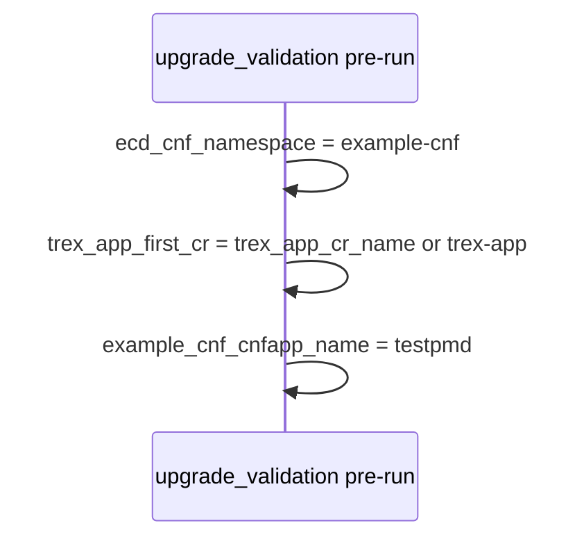
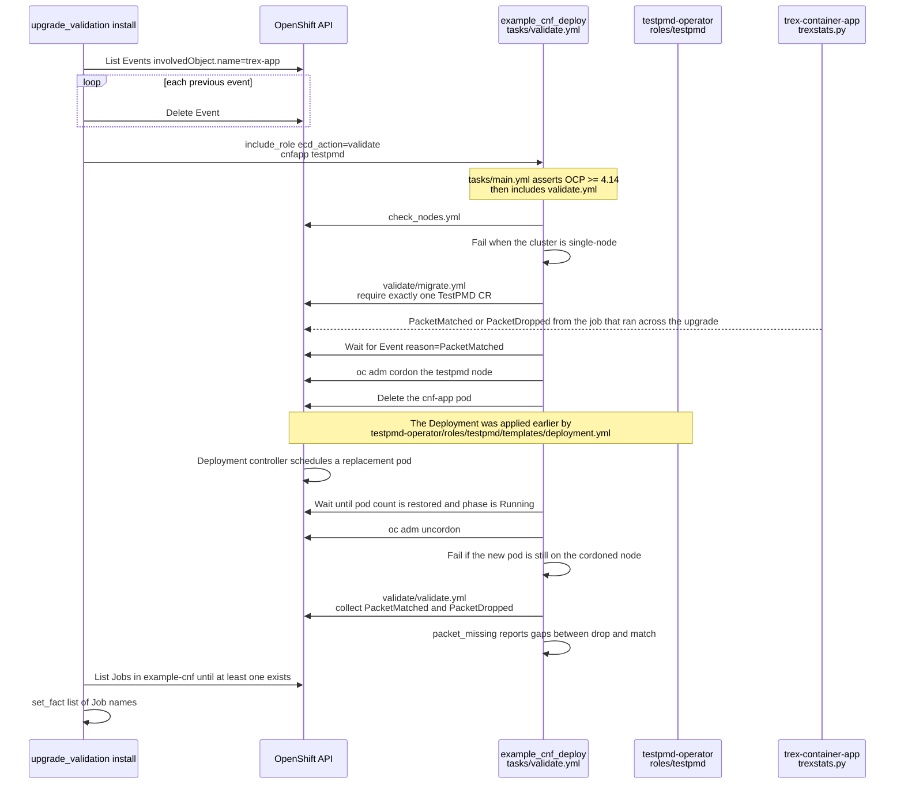

# Upgrade validation

This hook is expected to be run after an upgrade job, where the CNF app was running, with a meaningful TREX profile.

This hook prepares and launches the validation tasks from example_cnf_deploy role from [redhatci.ocp collection](https://github.com/redhatci/ansible-collection-redhatci-ocp/blob/main/roles/example_cnf_deploy/README.md).

To ensure the previous run of TRex (usually the default CR) is not polluting the results, all the event from the previous CR are removed.

Some variables than can be used for debugging purposes:

| Name                              | Required | Default    | Description                                      |
|-----------------------------------|----------|------------|--------------------------------------------------|
| trex_app_cr_name                  | Yes      | 'trex-app' | Name of the initial CR that will be cleaned      |
| example_cnf_cnfapp_name           | No       | testpmd    | CNFApp to be used. Only "testpmd" can be used    |

## Continuous burst ending - WIP

Covering the case where the TRex profile duration has been set to '-1'. TBD.

## Automation

This scenario assumes [cnfapp](../cnfapp/README.md) already deployed TestPMD and a TRex job, and that an OpenShift upgrade has finished. The hook then reuses `ecd_action: validate` from [`example_cnf_deploy`](https://github.com/redhatci/ansible-collection-redhatci-ocp/blob/main/roles/example_cnf_deploy/tasks/validate.yml). Operators stay in place: the TestPMD operator recreates the pod after deletion, and [trexstats.py](https://github.com/openshift-kni/example-cnf/blob/main/trex-container-app/app/pyfiles/trexstats.py) is the source of `PacketMatched` and `PacketDropped` events.

### Pre-run

[hooks/pre-run.yml](hooks/pre-run.yml) records the namespace, the previous TRexApp name, and TestPMD as the CNF application.

### Install

[hooks/install.yml](hooks/install.yml) drops events from the TRexApp that ran across the upgrade, then runs the same migration and packet-loss checks as the cnfapp tests hook.

